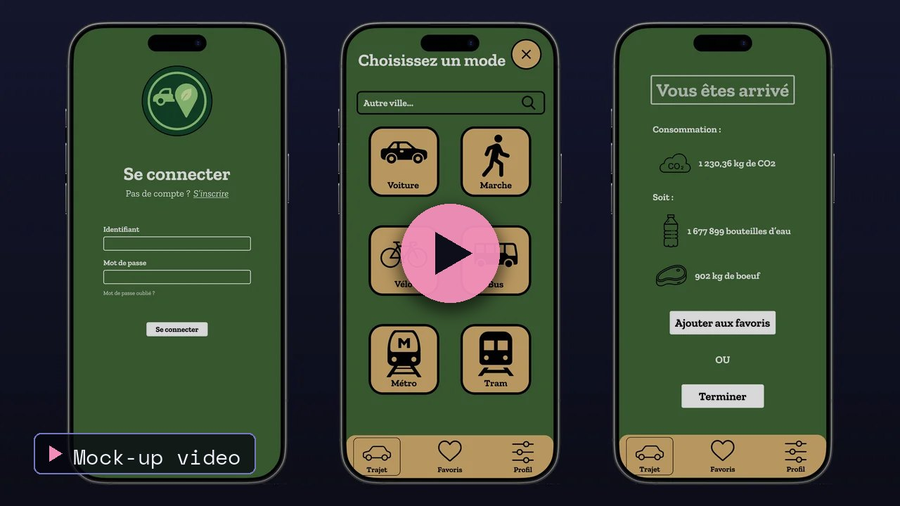
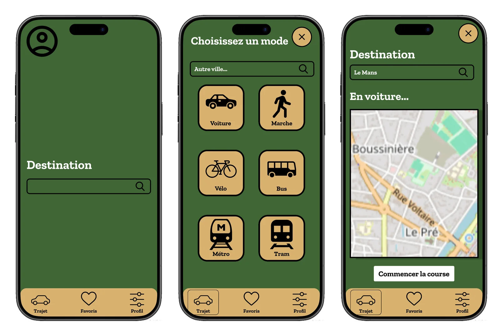
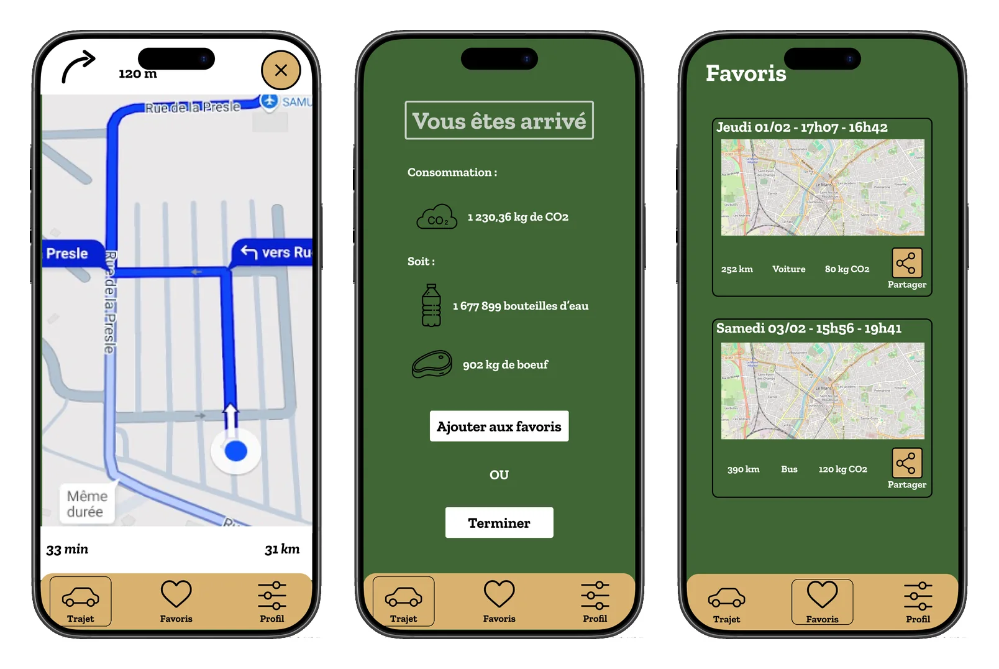
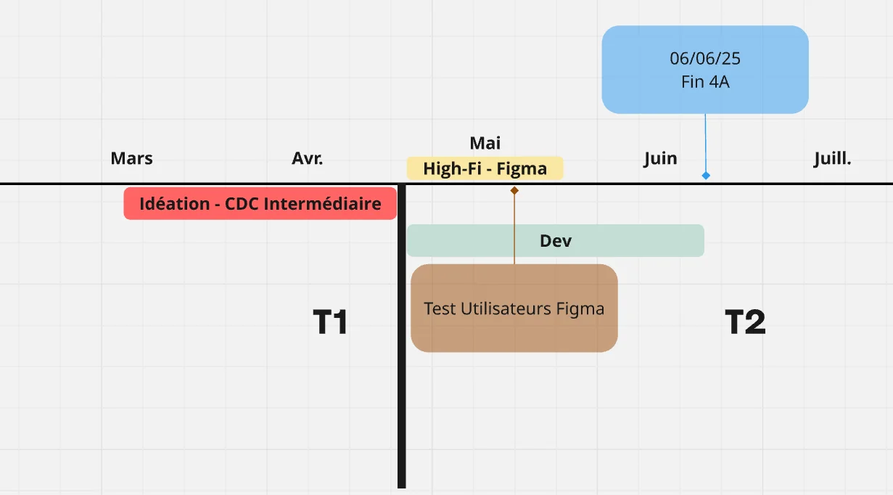
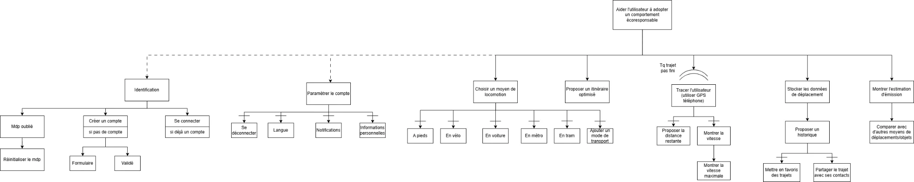
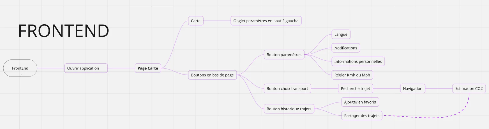
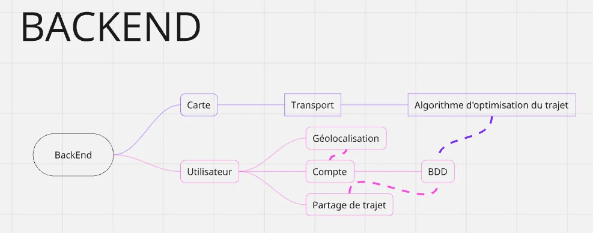

<a href="https://thibautplatet.com/en/projects/vert-le-chemin.html"><picture><source media="(prefers-color-scheme: dark)" srcset="https://raw.githubusercontent.com/ThibPltt/ThibPltt/main/assets/repos/Vert-le-chemin-dark.svg"><source media="(prefers-color-scheme: light)" srcset="https://raw.githubusercontent.com/ThibPltt/ThibPltt/main/assets/repos/Vert-le-chemin-light.svg"></picture></a>

# Vert le Chemin

Android app that estimates the CO₂ of a daily trip, to encourage choosing a less polluting means of transport.

<a href="https://www.youtube.com/watch?v=6KR983nNHtM"></a>

| At a glance | |
|---|---|
| **Dates** | 2025 |
| **Context** | mobile app · solo project · ENSIM |
| **Technologies** | Android · Kotlin · Jetpack Compose · Firebase · Figma |
| **Video** | [Low-fi mock-up on YouTube](https://www.youtube.com/watch?v=6KR983nNHtM) |
| **Case study** | [thibautplatet.com/en/projects/vert-le-chemin.html](https://thibautplatet.com/en/projects/vert-le-chemin.html) |

## Problem

How can people be encouraged to use less polluting means of transport? Show what a daily trip emits, and compare it with everyday consumption.

## Role

Solo project, ENSIM 4th year (Interaction Personnes-Systèmes): specification, mock-ups and Kotlin prototype.

## Decisions

Rely on ADEME’s official figures; compare emissions with everyday items; adapt the route to the means of transport; never show more than nine elements on a screen.

## Result

A specification, a low-fi mock-up, a high-fi Figma prototype tried by classmates, and a Kotlin prototype: account, destination, means of transport, map, navigation, arrival screen. Improvements are planned.

## The idea

Someone makes the same trip every day, for instance to Le Mans Université, with the means of transport of their choice. Vert le Chemin estimates the CO₂ emitted by that trip and compares it with other activities or productions, so that the figure means something.

The app guides the trip, then lets the user save it and share it: comparing the emissions of one trip across means of transport encourages a change. Some apps already estimate the CO₂ of a trip; the comparison with everyday activities, from ADEME’s figures, is what sets the project apart.

## Build and result

Built in iterations: first a simple prototype that reflects how the app works, then the details and the styling, finally the links between screens.

- A specification: need, state of the art, risks, schedule, evaluation protocol.
- A low-fi mock-up, then a high-fi Figma prototype, tried by classmates.
- A task tree and the frontend and backend diagrams.
- An Android prototype in Kotlin, from the account to the arrival screen.

Next steps: computing the route and the emissions from ADEME’s figures, favourites and trip sharing.

## The reference journey

A daily trip between home and the workplace, mocked up in Figma.

- **Sign in**, the first time the app is opened: the credentials are then kept.
- **Enter the destination**, for instance Le Mans Université.
- **Choose the means of transport** to get there.
- **Start the trip.** The app suggests a route suited to the chosen means; the “Commencer la course” (start the trip) button starts the navigation.
- **Arrive.** A screen confirms the arrival, with confetti, the CO₂ estimate and its everyday equivalents.
- **Save and share.** The trip joins the favourites, with its date, duration and distance, and can be shared.



<sub>From the start to the suggested trip: destination, means of transport, route.</sub>



<sub>From navigation to favourites (values of the mock-up).</sub>

## The Kotlin prototype

Kotlin with Jetpack Compose (Material 3), on an MVVM architecture, with Hilt for dependency injection and Navigation Compose to move from one screen to the next.

| Screen | What it does |
|---|---|
| **Sign-in and registration** | Account by e-mail and password with Firebase Authentication; the format of the e-mail and the length of the password are checked, and the session is kept. |
| **Means of transport** | Six means to choose from: walking, bike, bus, metro, tram, car. |
| **Destination** | Search in a list of cities, on an OpenStreetMap map (osmdroid) that shows the destination and the user’s position. |
| **Navigation** | Map and GPS tracking of the position, with a sample route. The client of the Valhalla routing API (Retrofit) is written. |
| **Arrival** | Confetti, CO₂ emissions and everyday equivalents (sample values), then back to the home screen. |
| **Settings** | Personal information, notifications, language, data deletion, sign-out. |
| **Menu** | A bar at the bottom of every screen: trip, favourites, settings. |

The code lives in `app/src/main/java/com/thibautplatet/vertlechemin/`: screens under `ui/theme/screen/` (`login`, `register`, `home`, `trajet`, `favoris`, `parameters`), the Valhalla client under `screen/login/trajet/Valhalla/`, navigation in `NavGraph.kt`, dependency injection in `di/Appmodule.kt`.

## Interface choices

- **Similarity and continuity (Gestalt):** the same icons, the same font and the same colours for the same kinds of action, from one screen to the next.
- **Miller’s law:** never more than nine elements on a screen.
- **Going back is always possible:** a cross at the top right, with a confirmation for some actions, and the bottom menu on every screen.
- **Simple, large, well-spaced elements,** so as not to overload the user.
- **Colours:** green and brown for the ecological purpose; yellow marks what can be tapped, red a wrong entry.

## Planned evaluation

- **Hypotheses:** users choose their means of transport according to the trip, adapt it thanks to the estimates and comparisons, save and share their trips to stay motivated.
- **Usability:** a SUS score above 72.
- **Features evaluated:** choice of means, navigation, CO₂ estimate and comparisons, favourites, sharing.

## Design

The schedule, then how the app works: a task tree and two diagrams (figures in French).



<sub>The project schedule.</sub>



<sub>The task tree.</sub>



<sub>The frontend: the screens and how they follow one another.</sub>



<sub>The backend: map, transport, account and database.</sub>

## Run it

```bash
git clone https://github.com/ThibPltt/Vert-le-chemin.git
```

Open the folder in Android Studio, let Gradle sync, then run the `app` configuration on a device or an emulator (Android 9 or later: min SDK 28, target SDK 35).

Tests and build from the command line (JDK 17):

```bash
./gradlew testDebugUnitTest   # form validation rules
./gradlew assembleDebug       # app/build/outputs/apk/debug/
```

The same steps run on GitHub Actions ([`.github/workflows/android.yml`](.github/workflows/android.yml), *Actions › Android build › Run workflow*); the debug APK is attached to each run.

Sign-in uses Firebase Authentication: `app/google-services.json` only holds placeholders, so replace it with the file of your own Firebase project (Firebase console › Project settings › Your apps, package `com.thibautplatet.vertlechemin`) for accounts to work.

## Credits

Solo project by Thibaut Platet, ENSIM, 2025. More on [thibautplatet.com](https://thibautplatet.com/en/projects/vert-le-chemin.html).

## Licence

Released under the [MIT licence](LICENSE).

<details>
<summary>🇫🇷 En bref</summary>

Application Android (Kotlin, Jetpack Compose) qui estime le CO₂ d’un trajet quotidien et le compare à des consommations du quotidien, pour encourager un moyen de transport moins polluant. Projet seul de 4e année à l’ENSIM : cahier des charges, maquettes basse et haute fidélité (Figma), prototype Kotlin du compte jusqu’à l’écran d’arrivée. Fiche complète sur [thibautplatet.com](https://thibautplatet.com/projets/vert-le-chemin.html).
</details>
